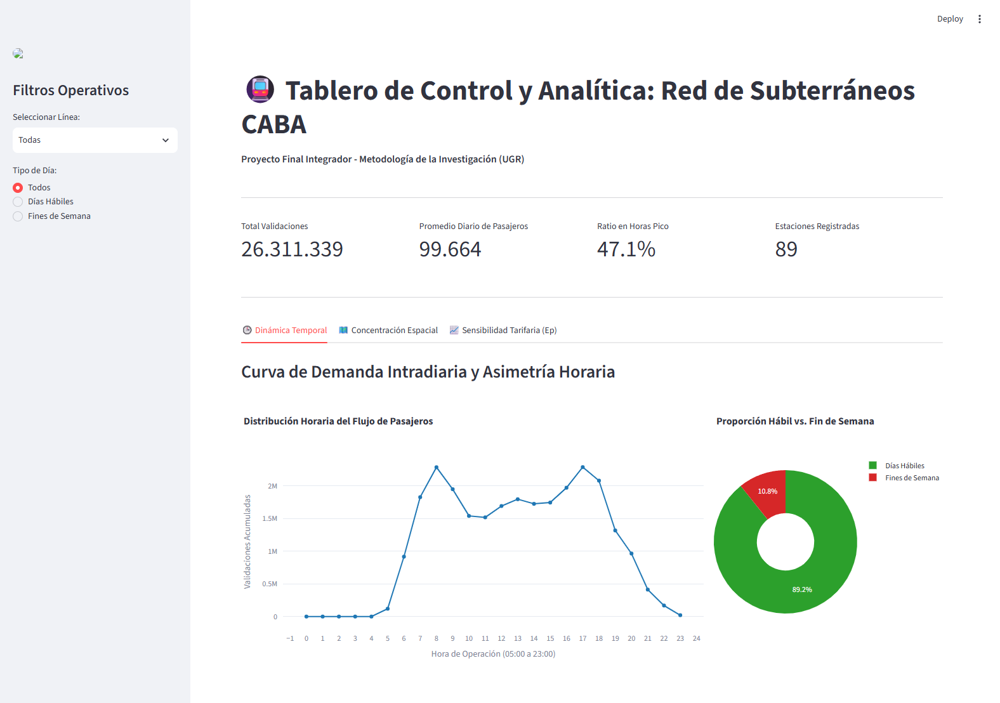
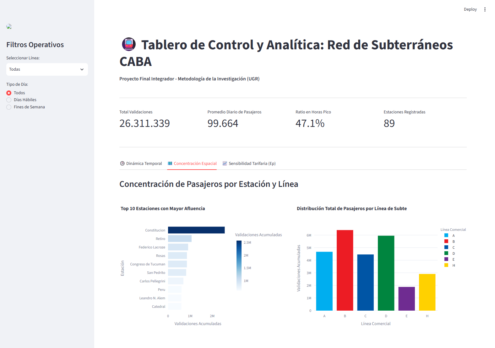
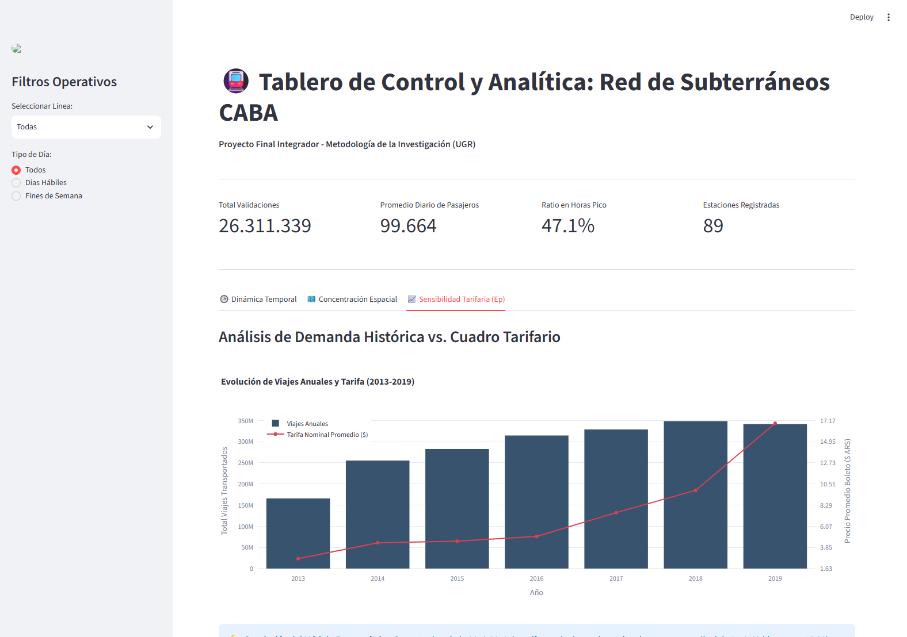

# 🚇 Manual de Usuario: Tablero de Control y Analítica - Red de Subterráneos CABA

**Trabajo Final Integrador — Metodología de la Investigación**  
**Licenciatura en Ciencia de Datos — Universidad del Gran Rosario (UGR)**  
**Grupo 31:** Leonel Rivera, Cristian Brandino, Bruno Suarez  

---

## 📌 1. Introducción y Propósito del Tablero

El **Tablero de Control y Analítica** es una aplicación interactiva desarrollada en **Streamlit** y **Plotly** diseñada para monitorear, explorar y analizar el comportamiento espaciotemporal de la demanda de pasajeros en la red de subterráneos de la Ciudad Autónoma de Buenos Aires (CABA), así como evaluar la sensibilidad econométrica frente a las variaciones del cuadro tarifario.

La aplicación opera sobre microdatos consolidados de validaciones en molinetes (`subte_procesado.csv`), series históricas de cuadros tarifarios (`registro-historico-del-precio-del-boleto.csv`) y volúmenes anuales de viajes transportados (`viajes_anual.csv`).

---

## 🎛️ 2. Barra Lateral: Filtros Operativos

Ubicada en el panel izquierdo de la pantalla, permite segmentar dinámicamente la información de todo el tablero en tiempo real.

| Control | Opciones Disponibles | Descripción e Impacto Metodológico |
| :--- | :--- | :--- |
| **Seleccionar Línea** | `Todas`, `A`, `B`, `C`, `D`, `E`, `H` | Filtra el conjunto de datos por la línea comercial seleccionada. Al cambiar este valor, se recalculan inmediatamente los KPIs y las distribuciones de estaciones y franjas horarias. |
| **Tipo de Día** | `Todos`, `Días Hábiles`, `Fines de Semana` | Discrimina entre días laborables de lunes a viernes (`ES_HABIL = True`) y fines de semana sábado/domingo (`ES_HABIL = False`), aislando los patrones de movilidad laboral de los recreativos. |

---

## 📊 3. Tarjetas de Indicadores Principales (KPIs)

En la parte superior se presentan cuatro métricas síntesis del subconjunto de datos filtrado:

| Métrica | Valor Global | Qué mide e interpretación |
| :--- | :---: | :--- |
| **Total Validaciones** | `26.311.339` | Suma agregada de accesos por molinete registrados en el período analizado bajo los filtros activos. |
| **Promedio Diario de Pasajeros** | `99.664` | Media aritmética de validaciones diarias agrupadas por fecha (`FECHA`). Dimensiona la afluencia media de una jornada estándar. |
| **Ratio en Horas Pico** | `47.1%` | Porcentaje de validaciones acumuladas durante las franjas críticas: **Pico Mañana** (07:00 a 09:59 hs) y **Pico Tarde** (16:00 a 18:59 hs). Revela que casi 1 de cada 2 pasajeros viaja concentrado en solo 6 horas del día. |
| **Estaciones Registradas** | `89` | Conteo de estaciones únicas (`ESTACION.nunique()`) con movimiento activo en la selección (la red completa cuenta con 89 estaciones operativas). |

---

## 🕒 4. Pestaña 1: Dinámica Temporal

Esta pestaña evalúa cómo se distribuye la afluencia de pasajeros a lo largo del día y según el tipo de jornada.

### 4.1 Distribución Horaria del Flujo de Pasajeros
- **Tipo de Gráfico:** Línea con marcadores interactivos (Plotly).
- **Ejes:**
  - **Eje X (Horizontal):** Hora de operación comercial del servicio (de 05:00 a 23:00 hs).
  - **Eje Y (Vertical):** Validaciones acumuladas de pasajeros.
- **Qué muestra:**
  - Una clara **curva bimodal** asimétrica, característica de redes de transporte metropolitano laboral.
  - **Pico Mañana:** Alrededor de las **08:00 hs** (~2.3M validaciones), correspondiente al flujo masivo de ingreso laboral y escolar hacia las áreas centrales.
  - **Meseta intermedia (Horas Valle):** Entre las 10:00 y las 15:00 hs, la demanda se estabiliza cerca de 1.5M a 1.7M de viajes por hora.
  - **Pico Tarde:** Entre las **17:00 y 18:00 hs** (~2.3M validaciones), marcando el retorno laboral hacia los hogares y cabeceras.
  - **Declive nocturno:** A partir de las 19:00 hs desciende abruptamente hacia el cierre operativo a las 23:00 hs.

### 4.2 Proporción Hábil vs. Fin de Semana
- **Tipo de Gráfico:** Gráfico circular tipo anillo (Donut Chart).
- **Valores y Porcentajes:**
  - **Días Hábiles (Verde):** **89.2%** del volumen global de viajes.
  - **Fines de Semana (Rojo):** **10.8%** del volumen global de viajes.
- **Interpretación Metodológica:** Confirma empíricamente que la red de subterráneos de CABA atiende primordialmente una demanda cautiva de carácter laboral-pendular, con un uso recreativo o social significativamente menor durante sábados y domingos.

---

## 🗺️ 5. Pestaña 2: Concentración Espacial

Esta vista desagrega la demanda a nivel de red por estaciones individuales y líneas comerciales.

### 5.1 Top 10 Estaciones con Mayor Afluencia
- **Tipo de Gráfico:** Barras horizontales ordenadas de menor a mayor con mapa de calor azul.
- **Hallazgos Clave:**
  - **Constitución (Línea C):** Lidera con amplia distancia superando los 2.5M de validaciones. Es el principal nodo de transferencia intermodal con el Ferrocarril General Roca (zona sur del conurbano bonaerense).
  - **Retiro (Línea C):** Segunda estación en afluencia (~1.4M), articuladora con las líneas ferroviarias Mitre, San Martín y Belgrano Norte.
  - **Cabeceras neurálgicas:** Federico Lacroze (Línea B - FFCC Urquiza), Rosas (Línea B), Congreso de Tucumán (Línea D) y San Pedrito (Línea A).
  - **Estaciones del microcentro:** Carlos Pellegrini, Perú, Leandro N. Alem y Catedral completan el Top 10 como nodos de absorción del empleo terciario, financiero y gubernamental.

### 5.2 Distribución Total de Pasajeros por Línea de Subte
- **Tipo de Gráfico:** Barras verticales por línea comercial codificadas con los colores institucionales oficiales de SBASE.
- **Distribución de las Líneas:**
  - **Línea B (Rojo `#EC1C24`):** La línea más transitada de la red (más de 6.5M de viajes), vinculando Villa Urquiza con el Bajo porteño vía Av. Corrientes.
  - **Línea D (Verde `#00853F`):** Segunda línea de mayor captación (~6M de viajes), corredor norte Belgrano - Palermo - Microcentro.
  - **Línea A (Celeste `#00AEEF`):** Eje histórico Rivadavia oeste (~4.7M de viajes).
  - **Línea C (Azul `#0055A5`):** Eje transversal Constitución - Retiro (~4.5M de viajes).
  - **Línea H (Amarillo `#FFD100`):** Eje transversal sur-norte en consolidación (~3M de viajes).
  - **Línea E (Violeta `#6F2C91`):** La línea con menor demanda relativa (~1.9M de viajes), con menor densidad comercial en su traza histórica sur.

---

## 📈 6. Pestaña 3: Sensibilidad Tarifaria ($E_p$)

Dedicada al modelado econométrico del comportamiento de la demanda frente al precio del boleto.

### 6.1 Gráfico Dual: Evolución de Viajes Anuales y Tarifa (2013-2019)
- **Tipo de Gráfico:** Combinado de barras y líneas con doble eje Y independiente.
- **Eje Y Izquierdo (Barras Azules):** Total de viajes transportados anualmente (escala de 0 a 350M).
- **Eje Y Derecho (Línea Roja con Marcadores):** Tarifa nominal promedio anual del boleto en pesos argentinos ($ ARS).
- **Eje X:** Años de la serie histórica (2013 a 2019).

### 6.2 Interpretación Econométrica y Elasticidad de Arco

La **Elasticidad Precio de la Demanda de Arco ($E_p$)** cuantifica la variación porcentual de la cantidad demandada ante una variación porcentual en el precio promedio entre dos períodos:

$$E_p = \frac{\Delta Q / \bar{Q}}{\Delta P / \bar{P}} = \frac{(Q_{2019} - Q_{2018}) / \left(\frac{Q_{2019} + Q_{2018}}{2}\right)}{(P_{2019} - P_{2018}) / \left(\frac{P_{2019} + P_{2018}}{2}\right)}$$

- **Incremento tarifario medio (2018-2019):** De $\$9,83$ a $\$16,88$ (**$+71,61\%$**).
- **Contracción en la demanda (2018-2019):** De $348,4\text{M}$ a $341,3\text{M}$ de pasajeros (**$-2,03\%$**).
- **Resultado del cálculo:** 
  $$E_p = -0,0388$$

> **💡 Conclusión Metodológica:**  
> Como $|E_p| < 1$ (específicamente muy cercano a cero), se comprueba de manera rigurosa que el servicio de subterráneos presenta una **demanda altamente inelástica**. Los usuarios no pueden sustituir fácilmente este medio de transporte ni prescindir de él ante aumentos tarifarios debido a la congestión del tránsito en superficie y la rigidez de los horarios laborales en el Área Metropolitana de Buenos Aires.

